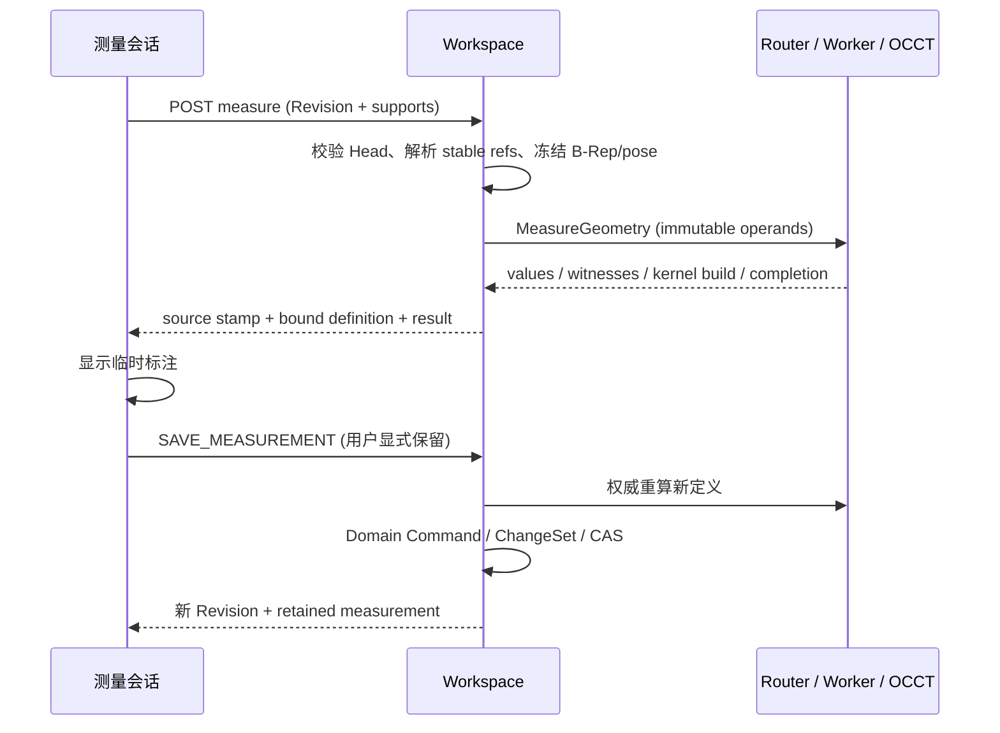

# 几何测量

Part/Product 共用三条命令：测量对象、测量之间、三点角度。临时计算只读；显式保留才创建 Revision。保留对象可重开、命名、隐藏、更新、删除及撤销重做，来源变化时保留旧证据并标记过期。测量产生只读数量参数，可通过公式驱动其他 Body；来源变化后，依赖过期输出的几何暂停计算，保留上次显示，显式更新测量后恢复。

源码入口：[Workspace](../../../services/internal/workspace/measurement.go)、[OCCT](../../../kernel/occt/src/measurement.cpp)、[面板](../../../web/apps/cad/src/features/workbench/measurement-panel.tsx)、[标注](../../../web/apps/cad/src/cad/measurement/measurement-overlay.ts)。[CATIA 来源与有意差异](../../references/catia-measurement.md)是参考行为，不代表已交付其全部模式。

## 用户流程与范围

共同目录 `measurement` 通过 placements 进入 Part Design 和 Assembly Design 的建模 Tab。命令 ID 为 `measure.item`、`measure.between`、`measure.angle-points`；工具栏、搜索、结构树编辑继续使用同一个 CommandRegistry 和 CommandOperation。Viewer 可以只读计算，编辑者才可保留。草图编辑、嵌套编辑、机构或组件位置预览期间不开放根测量。

选项分为选择过滤与下一选择取用方式。任意/顶点/边/面/实体或组件过滤影响树与视区的共同 FeatureSelectionSession；实际边界、圆心/球心、解析轴线是显式含义，不从点击位置自动猜测。已选字段显示其取用方式。两个字段可以来自同一 Part 的不同拓扑，也可以来自不同或重复 occurrence。

顶点/边过滤只在拾取字段激活期间临时显示所需拓扑，结束后还原用户显示偏好，不揭示隐藏 Body。首次 pointerup 后保留配对状态并激活下一字段；第二次选择后自动请求精确计算。三点命令按端点、顶点、端点收集。字段可替换或清除，取消拾取优先于关闭对话框。定义、文档或 Revision 变化会取消旧请求，迟到结果必须通过 scope/代际检查。数值计算最多 30 秒，关闭会取消在途只读请求。

“完成”结束临时会话。“随文档保留”启用正式保存；“保留并继续”先确认保存成功才进入下一对。独立模式清空；链式以第二项作为下一首项；扇形保留首项。已保留列表提供打开、隐藏和删除，结构树对象提供编辑、刷新和删除。失败时表单保留输入及原因，不替换已接受结果。

| 对象/计算 | 当前数值及语义 |
|---|---|
| 顶点、圆/椭圆中心、球心 | owning Part/Product 坐标系中的 XYZ |
| 直线/一般曲线边 | 有限修剪边的精确积分长度、参数起终点、几何形心、包围尺寸 |
| 圆边 | 上述属性、半径/直径、圆心、圆弧参数角；椭圆分别给主/次半径，不将椭圆主半径理解成曲率半径 |
| 面 | 精确面积、排除周期参数接缝后的边界周长、几何面积形心、包围尺寸；解析圆柱/球/圆环等提供相应半径和方向提示；圆柱轴线上一点、锥顶与真正的中心分开命名 |
| Body、Part/Product occurrence | 非 consumed 且已成功求值 Body 的精确边界面积、几何体积、体积形心及共同包围尺寸；集合逐 Body 聚合，不先做布尔融合，重叠体积不扣除 |
| 实际几何之间 | 冻结 B-Rep 的最短距离及一对见证点，ΔX/Y/Z 为第二点减第一点；多个等价解选择内核返回的一对，不承诺唯一性或跨更新连续性 |
| 圆柱/圆锥/圆/圆环的轴 | 无限解析直线；支持轴—轴及轴—精确点/中心的解析最短距离；单对象无限轴无长度 |
| 解析线/轴/平面夹角 | 与距离同时给出无向最小夹角；线—面为直线与平面的角，范围 0–90°，不是法向夹角。圆边轴向不冒充边切线方向 |
| 三点角度 | 第二点为顶点，0–180°；重复顶点/零长臂拒绝；不使用相机方向选择有向补角 |

计算中的“精确”指使用 B-Rep/解析几何及数值容差求值，不代表任意精度数学证明。最短距离使用 OCCT extrema、`1e-7 mm` 计算精度；没有 mesh fallback。体积/面积/形心是纯几何积分，不读取材料、密度、质量或惯量。包围尺寸采用内核的曲线/曲面边界计算，显示框不是加工公差保证。

## 数据、来源与历史

`PartModel.measurements[]` 和 `ProductModel.measurements[]` 使用同一 Measurement 定义，稳定 UUID 为身份。支持项保存 Body ID、typed InstancePath、PersistentSelection 及选择源 Revision；显示名、GeometryKey 和 local topology ID 不作为持久选择。原始点击只在 POST 输入携带当前 GeometryKey/local ID，服务器在冻结的实际来源 Revision 上绑定后清除它们。

Product 从当前 Revision 的已接受引用边展开，不跟随远端 Head，不调用装配求解。持续引用核对每一段 owner Document、Instance ID、referenced Document，再解析当前接受的 Revision；同一路径字符串但引用对象被替换不会重绑。嵌套位姿组合后仅施加一次。圆心/轴线在精确拓扑解析后构造，不持久化为脱离来源的坐标点。

共同 versioned handler `occccad://document/measurements/set` 写 `document.measurements` PropertySlot。REST 命令为 `SAVE_MEASUREMENT`、`UPDATE_MEASUREMENT`、`DELETE_MEASUREMENT`，必须带当前 versionId。共同 `UPDATE_DERIVED` 适配测量、空间分析及整组更新；结果在事务外计算，单次 CAS 接受整批证据，失败保留原结果。新/变更定义由服务器重新计算，不采信浏览器提供的结果。临时预览使用只读 measure 查询，通用 PreviewCommand 不接受测量写入，避免误入 Part 重建或装配姿态预览。仅名称/显示变化复用已接受证据；显式更新才替换证据。未被公式消费的测量写入沿用冻结几何；已有测量结果更新会产生 `measurement:<id>` 影响种子。存在消费关系时按依赖图分阶段计算 Body，不能用单 Body 预览跳过下游门禁。测量不改变装配姿态。

结果是小型派生证据：source Revision、来源 stamp、算法 policy、kernel build、单位后缀明确的数值及少量锚点。没有把 B-Rep、Mesh 或尺寸线采样数组塞入参数模型。输出参数由测量 UUID 和输出槽确定性派生 `ParameterId`，`source.produced` 指向生产者，禁止修改值/来源，别名可重命名。已被公式或发布接口使用的输出不能随测量直接删除；消失的结果槽保留为不可用，不能继续提供旧值。

`CURRENT / STALE / BROKEN / MISSING / UNKNOWN` 是只读投影，分别表示当前来源与证据一致、来源变化需更新、来源无法解析、没有结果及暂时无法判断。共享依赖引擎见[模型与参数](model-history.md#参数依赖与增量求值)。测量声明 intrinsic、relative、frame 三类输入摘要：Body 几何键/拓扑支持决定内在属性；相对位姿决定对象间距离/角度；绝对 owner frame 决定 XYZ/分量/包围尺寸。Revision 仅作证据，不单独使结果过期。无关参数、重命名、显隐及保存自身不会使结果过期。单面面积在刚体移动后仍有效，标签锚点施加新旧 owner frame 的差变换；坐标类输出独立标为待更新。方向向量与位置锚点的含义保留在原始结果中。

公式只消费 CURRENT 测量输出。Part evaluator 按全图排序 Body，来源 Body 先计算，刷新测量时效，再计算消费者；过期输出使下游 BLOCKED，保留上次显示。禁止同一 Body 最终结果测量反过来驱动该 Body 的反馈；跨 Body 依赖允许且仍检查循环。发布接口区分连接状态和 `currencyStatus`，过期值可查看，跨文档显式接受时拒绝。读取不自动重算测量或写历史。

## 计算边界与协议

`POST /api/documents/{id}/measure` 要求 Viewer 权限及精确 owning Revision。控制面解析选择后，通过 Go geometry client、GeometryPool 转发新的 `MeasureGeometry` RPC；LOCAL/S3 继续经过 ArtifactStaging。Worker 请求只持有不可变 B-Rep references、瞬时拓扑 locator、分组 operands 和刚体位姿，不接触数据库或 OCCT 持久身份。

一次最多 128 个支持实体、256 MiB 去重 B-Rep；最多保留 128 个测量。Worker 验证输入集合、placement、B-Rep digest 与资源上限，等待共享计算锁时可取消；距离求值使用 OCCT progress cancellation。响应最多 32 个数值、16 个锚点，Go 验证有限性、完成状态、必要字段及距离与见证点一致。计算失败不返回可显示的部分证据。属性积分中的单次 OCCT 调用没有中途 progress hook，取消在调用间及返回前检查，不承诺硬实时中断。

## 视图区呈现所有权

`MeasurementOverlay` 由 CadViewportEngine 创建/销毁，使用 SVG 覆盖层；既有 Three.js 场景继续拥有实体、拾取与高亮。层不注册成 CAD 几何，不污染 bounding fit 或拓扑拾取。每个有效结果由独立绘制对象投影：

- 距离：计算出的见证点及 1/2 标记、带端点引出的尺寸线、双箭头、读数；零距离仍显示点和标签，不除以零。XYZ 分量采用三段折线，分别显示有符号变化。
- 对象属性：几何形心/位置标记、到结果牌的引线、有限边端点与显示包围框；圆边额外显示圆心至圆周的径向线。包围框和辅助虚线的语义与实际形状边线分开。
- 三点角度：两条臂、端点/顶点及短角度弧；弧半径按较短臂的 28% 选择，仅是显示参数。
- 标签：字体、箭头、端点保持 CSS 像素尺寸，主标签深底浅字，辅助线半透明。位于相机裁剪范围外的锚点不绘制；标签限制在视口内，默认尝试避开其他标签，可拖动并双击复位。

底牌拖动拥有 pointer capture、up/cancel/lost capture、blur 和 Esc；Esc 还原拖动前位置。拖动不请求测量、不写 Revision/Undo。`document_presentation` 保存文档/测量 ID 下的 CSS 像素偏移，GET/PUT `annotation-layouts` 使用独立 version CAS；双击复位也保存，重开恢复。Viewer 可读布局；编辑者能持久保存。单对象请求合并、冲突后显式重试，不跨文档采用迟到响应。它不进入几何缓存、参数或分析摘要。删除测量后布局不再投影；Undo 恢复同一身份时可恢复该布局。

过期测量仍绘制上次见证点、琥珀色虚线及“上次值 / 待更新”；断裂来源用红色；过期分量不伪装为当前坐标。隐藏是统一显示命令，依然可更新及消费有效输出。相机移动重新投影，Sketch/位置预览或机构状态隐藏不相容标注。普通模型选择和悬停仍走既有 Selection 生命周期。

## 限制及验证入口

当前不支持 ContextVariant 专用拓扑、Datum/Sketch 解析几何、任意自定义测量坐标系、网格近似测量、最大距离/垂直偏差、厚度、任意曲线交点切角、有向补角、从结果创建几何、自动更新。轴线与面或有限边的混合最短距离也未实现，会明确失败。根 Product 中的嵌套常规 occurrence 可测；打开嵌套编辑/机构姿态后不把显示预览当作已接受来源。

没有双向高亮所有已保存测量的关联支持，也没有全局标签最优排布；当前选择字段复用现有高亮，标签采用有限避让。需要 CAD 工程图级排版或大量常驻标注时须专项设计，不把现有 128 个定义上限理解成性能保证。

邻近测试：`Measurement.*` 原生场景、`measurement_test.go`、`measurement.scenario.mjs`；真实调用链为 `TestMeasurementPartProductHistoryAndAcceptedOccurrencesThroughRouter`；浏览器为 `measurement-live.spec.ts`。运行入口使用 `mise run check --scope geometry --match Measurement`、`--scope services --level integration --match TestMeasurement`、`pnpm --dir web/apps/cad exec playwright test --config playwright.live.config.ts measurement-live.spec.ts`。这些入口/测试存在不代表当次已经通过，执行结论以当次报告为准。

测量组（“测量”根节点）提供批量隐藏/显示，与单个测量共用正式显示命令。隐藏不删除输出参数，也不改变测量定义、精确结果或依赖证据；一次命令可撤销，组的显隐标记与成员实际可见状态保持一致。
