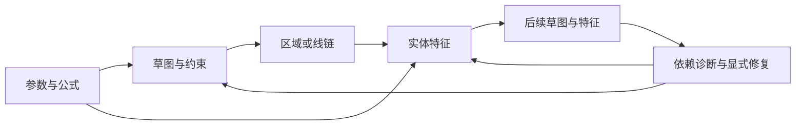

# 草图与实体的参数化设计流程

Part 建模的整体入口：参数驱动草图，草图区域/线链驱动实体，后续特征再引用上游结果。具体能力与限制以[实体能力表](solid-features.md#feature-能力表)为准。

## 连续建模

- 绘图按指针创建几何；线性、角度、半径等尺寸属于草图约束，使用正式尺寸工具编辑。草图与实体数量共用 ParameterId、单位、表达式和依赖；更换尺寸引用保留参数身份。
- 退出草图后启动实体命令。实体表单可新建/编辑输入草图并返回，保留数量原文、单位、意图及 occurrence；取消实体草稿不撤销期间已确认的草图操作。
- 轮廓可消费整草图或显式区域；无关开放线不阻断已验证区域。路径、孔位、支撑与终止引用保持稳定身份，失效后明确重选，不按位置或形状猜绑。
- 草图分类保留几何及尺寸约束；参数与接口独立展示。三维测量在 Part/Assembly 的测量分类使用。实体尺寸在表单编辑，几何输入从视区选择，操作错误走全局提示。

## 预览、修复与上下文

模型和不可变 Revision 是业务真相，B-Rep、Naming、Visual 是派生制品。预览不写历史，只有匹配当前 Revision、Root/Variant、occurrence 和意图的权威候选可提交；取消与迟到结果不能恢复旧候选。写入沿 Domain Command、ChangeSet/CAS 与补偿历史执行。

上游变化可留下可检查的 FAILED/BLOCKED 定义。依赖查看给出实际消费者；健康历史仅供对照，修复在当前合法输入上替换/移除引用，保留 Feature、Body、参数及历史位置。旧成功显示只供导航。

历史创建使用冻结前缀和实际 Body 阶段。直接 READY 的 Product ContextVariant 编辑还需验证独立默认构型及受影响 occurrence；深层、PINNED、非 READY 和跨 Body 创建的边界见对应领域页。

## 按问题展开

| 问题 | 权威入口 |
|---|---|
| 草图、尺寸、区域、支撑与关联偏移 | [Part/Sketch](part-sketch.md) |
| 实体能力、历史位置、预览与修复 | [实体 Feature](solid-features.md) |
| 终止、薄壁、Sweep、工程孔、放样 | [生成器](solid-generators.md) |
| 工具/材料范围复制、成员重执行 | [特征复制](feature-replication.md) |
| 参数与历史 / 实际求值链 | [模型历史](model-history.md)、[求值链](part-feature-evaluation.md) |
| 用户操作与检验 | [交互指南](../../guides/sketch-interaction.md)、[测试路由](../../../tests/README.md) |
| 性能样本与证据边界 | [检验与测量](../../validation/sketch-solid-workflow.md) |
