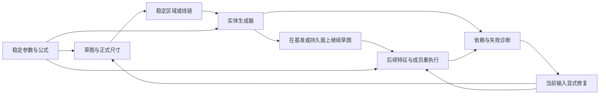

# 草图与实体的参数化设计流程

这是理解 Part 建模的整体入口。几何定义与不可变 Revision 是真相，B-Rep、Naming、Visual 是有来源、可重建的结果。具体范围由[唯一 Feature 能力表](solid-features.md#feature-能力表)维护；不要把目标文档、工具声明或单个算法成功当作交付保证。

## 连续建模与设计意图

绘图按鼠标位置创建几何，保留可约束自由度；需要驱动尺寸时使用正式尺寸工具或尺寸编辑器。草图尺寸与特征尺寸共享 ParameterId、Quantity、表达式、命名及依赖。阵列的数量、间距和角度也使用同一参数补全输入。更换尺寸几何引用保留尺寸身份；属性检查器保持只读，修改走正式编辑命令。

退出草图后可进入拉伸/旋转；草图工具栏、搜索和树插入菜单不提供实体生成命令。实体面板可以编辑或新建输入草图再返回，保留草稿、原始数量文字、单位、意图和 occurrence。Sweep 的截面与路径分别返回其输入位置。已提交的草图编辑保留历史，取消后续实体不抹除这些 Revision。实体尺寸与公式统一在表单编辑；视区不提供特征尺寸手柄。

实体可明确消费整草图或已验证区域；无关开放线不会阻断显式合法区域。区域身份取自正式边界关系，改变轮廓后缺失区域需重选。关联偏移保留来源、距离参数和连接；独立复制与解除关联具有明确语义，不生成隐藏固定约束或第二套草图真相。

建模、测量、参数与接口、视图是并列分类；Sketcher 同样将测量和参数管理独立展示。实体表单采用紧凑字段与选择列表；扫掠路径草图、路径曲线和薄壁线链通过视区拾取，保留逐项定位、更换和移除。操作失败、输入校验和下游修复提醒共用全局提示，原始诊断仍进入开发证据。

## 关联、预览与失败

[实体生成器](solid-generators.md)说明关联终止/偏移、薄壁、Sweep、工程孔及放样连续性的精确构造和边界。[特征复制](feature-replication.md)区分固定工具、净材料范围、实体阶段和成员位置重执行。持久输入采用 stable entity/region/Parameter ID、PersistentSelection 和 InstancePath；视口坐标、面序号、名称或几何相似度不承担身份。

交互草稿/鼠标移动不形成 Revision。权威预览检查当前输入、Revision、Root/Variant、occurrence 与意图，只有成功的当前候选可提交；新输入、取消和迟到响应不能恢复旧候选。提交经 Domain Command、幂等 Transaction、ChangeSet/CAS；Undo/Redo 补偿或重放，不抹历史。

上游变化可保留可检查的 FAILED/BLOCKED 定义，失败结果不携带旧成功 GeometryKey。Part 依赖查看给出实际参数、区域、支撑/路径/终止和实体阶段；健康历史对照仅用于观察。修复明确替换/移除当前输入，保留 Feature、Body、参数和历史位置；同形面、邻近边或另一健康区域不会自动接替。旧成功显示只供导航，不参与建模绑定。

## 历史与装配上下文

[历史位置创建和受约束移动](solid-features.md#在历史位置创建)使用冻结全局前缀和实际来源实体阶段。草图边界不是实体阶段；首个实体前的空 Body 输入不授权选择下游面。Body 创建者、Boolean/Pattern 等既有移动边界保持约束。

直接 READY 的 Product ContextVariant 编辑同时验证独立默认构型及受影响重复 occurrence，维持各自已接受的输入与位姿；不顺带读取来源 Head。绑定值是受控上下文输入，不覆盖独立默认参数。深层、PINNED、非 READY 上下文和跨 Body 历史创建不扩展为通用编辑承诺。

## 源码与检验

| 主题 | 入口 |
|---|---|
| 草图、约束、区域、偏移 | [Part/Sketch](part-sketch.md)、`model_core.go`、`sketch_curve_chain.go`、`sketch_linked_offset.go` |
| 参数、Revision 与依赖 | [模型/历史](model-history.md)、`evaluation_projection.go`、`part_dependencies.go` |
| 生成、复制、Naming 与阶段复用 | [求值链](part-feature-evaluation.md)、`solid_feature.go`、`service.go`、`occt_kernel.cpp` |
| 工作台操作 | [草图交互指南](../../guides/sketch-interaction.md)、`solid-sketch-workflow.ts`、`SolidFeatureEditor`、`PatternFeatureEditor` |
| 组合检验与测量 | [验证记录](../../validation/sketch-solid-workflow.md)、[测试路由](../../../tests/README.md) |

组合场景覆盖：开放主草图显式区域→抽壳与关联偏移双 Body→共享壁厚变化；重复 occurrence 中薄壁贯穿→成员重执行→Sweep 新 Body→多点工程孔；历史 Sweep 插入后继续原修饰。专项检验另覆盖放样支撑 G1/G2、路径/孔位/终止失效与显式修复、冷热重建和取消。测试入口存在不代表任何后续代码快照已执行通过；执行范围与未覆盖边界由验证记录说明。

Sketcher 的测量分类集中现有线性、角度及圆/椭圆尺寸工具；几何约束仍在草图分类。三维精确测量在 Part/Assembly 使用，不把该入口当作二维草图测量。
