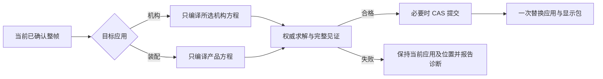

# DMU 运动机构缺陷分析与完整设计

本设计针对当前旋转机构的位姿跳变、退出回退、结构树层级、约束命名与操作语义。产品约束与机构约束继续独立；进入或退出应用时，以当前已确认位姿为输入，按目标应用的约束重新求解。没有目标约束时保留当前位置。生成产品约束必须经过显式转换。

分析基线为 `91f03aa`，日期为 2026-10-10。维护者随后授权实施，基础链路已按本方案接入；实际验证见[实施记录](kinematics-dmu.md)。下面的源码缺陷分析保留为整改依据，不代表修复后仍存在。维护者补充的切换规则取代旧的退出恢复产品快照语义。

## 事实和依据

| 依据 | 可以确认的范围 |
| --- | --- |
| 维护者提供的 `tests/test.data/dmu/dmu tree 01.png` | CATIA 实际创建对象的树层级、接合下的真实约束、固定零件下的固定约束、模拟中的机构引用投影 |
| 本机 CATIA B33 用户文档 | 接合构成、创建和编辑流程、更新同步、关闭仿真保留位置、显式复位、独立 Simulation 的录制语义 |
| 当前 Go 和 Web 源码及邻近测试 | 当前持久模型、实际恢复路径、树投影和转换行为；测试中的既有验收标准 |
| 维护者补充的应用切换规则 | 退出保留当前位姿并受产品约束求解；进入从产品当前位姿按机构约束重新计算，不继承产品方程 |

基线根因结论来自静态调用链。实施后已对独立验收 Product 运行真实浏览器逐帧采样，结果见实施记录；尚未对维护者的具体 Product 采样，因此不会把某一条异步时序认定为该实例唯一的跳变原因。

## CATIA 的对象与行为

### 文档入口与具体页面

入口是 `/mnt/s/tools/DS/Catia/B33doc/English/online/CATIAfr_C2/kinugCATIAfrs.htm`。该文件是 frameset，实际目录指向 `online/kinug_C2/kinugCATIAtoc.htm` 与 `kinugsm.htm`。入口已通过 `control/HPDoc_CATIA_P3C2.viewdoc` 定位，下列正文页通过 `control/KinEnglishC2.viewdoc` 核对。

下表的页面均相对于 `/mnt/s/tools/DS/Catia/B33doc/English/online/kinug_C2/`。

| 页面 | 核对后的行为及设计意义 |
| --- | --- |
| `kinugwd1000.htm` Specification Tree | Applications 下包含运动机构、固定件、接合、Command、速度和加速度等对象；Simulation、Laws 等还具有自己的对象类型 |
| `kinugbt0801.htm` More About Joints and Constraints | 普通旋转接合由轴线重合与平面偏移组成；其他类别还包括几何接合、复合接合和基于轴系的接合 |
| `kinugbt0701.htm` Creating Revolute Joints | 选择两轴和两平面，平面须垂直于所属轴；选择字段自动推进，可设置角驱动，确认后更新机构树 |
| `kinugbt0503.htm` Defining a Fixed Part | 固定零件是单独的机构操作，可以从树或视图区选择，并支持撤销 |
| `kinugbt0504.htm` Defining Commands | Command 可在创建接合时或之后添加；它驱动接合坐标，方向是相对运动意义，不能总解释成某个零件的绝对旋转方向 |
| `kinugbt0201.htm` Simulating with Laws | 用既有规律、时间范围与步数运行；关闭默认保留新位置；按规律运行和录制 Simulation 是不同流程 |
| `kinugbt0205.htm` Leaving Simulation in Modified Position | 关闭规律或 Command 仿真保留位置；重新进入规律仿真时可能因时间参数对应的 Command 值而发生有意义的位置改变 |
| `kinugat0800.htm` Resetting a V5 Mechanism | 复位是显式操作，区分上次仿真之前和文档加载时的状态；关闭仿真本身不等于复位 |
| `kinugbt0508.htm` Using the Update Command | CATIA 可通过 Update Positions 同步装配约束与接合；删除组成约束后，更新甚至会改变接合类型 |
| `kinugbt0302.htm` Recording Positions | 独立 Simulation 记录机构位置，包含起始状态，可录制多个机构 |
| `kinugbt0510.htm` Deleting Joints | 删除接合与删除关联约束是可区分的操作；不能从树父子关系推断所有关联对象都应级联删除 |

这些是 CATIA 用户行为，不推断其内部持久化、求解器或事务实现。截图中的“法线”分类结合文档中的 Laws 理解为运动规律，不设计成几何法向量功能。

### 截图表达的层级

```text
Applications
├─ 机械装置
│  └─ 机械装置.1，自由度=0
│     ├─ 接合
│     │  └─ 旋转.1 (Part2.1,Part2.2)
│     │     ├─ 相合.1 (Part2.1,Part2.2)
│     │     └─ 偏移.2 (Part2.1,Part2.2)
│     ├─ 命令
│     │  └─ 命令.1 (旋转.1,角度)
│     ├─ 固定零件 (Part2.2)
│     │  └─ 固定.3 (Part2.2)
│     ├─ 法线
│     └─ 速度和加速度
└─ 模拟
   └─ 模拟.1
      └─ 机械装置.1，自由度=0
         ├─ 接合
         ├─ 命令
         ├─ 固定零件 (Part2.2)
         ├─ 法线
         └─ 速度和加速度
```

关键是分类、定义对象与引用投影的区别。“机械装置”和“模拟”是集合；“接合”和“命令”是机构内的集合；固定零件下面还有实际 Fix。“模拟.1”下面出现机构并不要求复制第二份机构定义。

截图的自由度为 0 也不证明旋转被静态锁死：接合的物理自由度、Command 覆盖之后的剩余自由度须区分。当前数值实现要求无驱动时 relative DOF=1、gauge DOF=0，施加驱动坐标后为 0/0，与能运动的单旋转机构相容。

### 本项目采用的差异

保留接合组成、对象层级、统一约束表现、关闭保留位置与显式复位。产品约束与机构约束不共享可变定义；机构求解忽略产品约束，产品求解忽略机构约束。共同使用的只是约束语义、稳定几何引用、编译器和数值算法。

本项目没有 CATIA 的接合与产品约束更新同步机制。因此不在创建接合时写入产品约束，也不承诺编辑一边自动更新另一边。显式转换生成拥有独立身份的产品约束，并记录来源；转换后两边仍可独立存在。

## 当前调用链与缺陷

### 现有能力中可以保留的部分

当前 `MechanismJoint.constraints` 已持久保存普通 `AssemblyConstraint`，不是只画出来的两个虚拟图标。旋转接合绑定轴重合和平面偏移，Ground 绑定 SPACE Fix；机构输入清除 Product 方程后使用普通编译器。权威预览验证收敛、偏好、完整硬见证及关节闭合，保存经过 Revision/CAS。冻结运行和有效整帧回放也已有独立链路。

这些能力可复用。主要修复对象是应用切换、当前位姿的语义、异步显示交接、树投影及转换规则，现有证据不要求重写三维求解器。

源码入口：

- [持久模型](../services/internal/workspace/kinematics_model.go)、[关系绑定](../services/internal/workspace/mechanism_constraints.go)、[几何与角度基准](../services/internal/workspace/kinematics_geometry.go)。
- [权威预览](../services/internal/workspace/mechanism_preview.go)、[数值编译](../services/internal/workspace/kinematics_compile.go)、[冻结输入](../services/internal/workspace/motion_snapshot.go)、[运动执行](../services/internal/workspace/motion_run.go)。
- [操作面板](../web/apps/cad/src/features/workbench/motion-study-panel.tsx)、[工作台](../web/apps/cad/src/features/workbench/workbench.tsx)、[视口接线](../web/apps/cad/src/viewport/cad-viewport.tsx)、[视口引擎](../web/apps/cad/src/viewport/cad-viewport-engine.ts)。

### 位姿为什么先恢复再变化

| 位置 | 代码事实 | 后果 |
| --- | --- | --- |
| `motion-study-panel.tsx` 223 至 238 行 | 每次启动草稿预览，先 `onPreview(acceptedPoses.current)`，收到结果才显示新的 `instancePoses`；草稿结果不提升为 accepted | 两轴预览后继续选平面或修改偏移，会先退回操作前基准，再显示新解；即使所有回调都有值，也会往返跳变 |
| 同文件 116 行及 `workbench.tsx` 1534 行 | 保存先经 `onSave → refresh(updated)` 更新 Query，之后才返回面板、设置 ownedRevision 和关闭命令 | 文档已更新与面板旧闭包/旧 accepted 基准存在交接窗口；关闭和后续 effect 可以再次显示旧基准 |
| `cad-viewport.tsx` 173 至 186 行 | `render(view)`、`setMotionDisplay`、`showMechanism` 分别由独立 effect 驱动 | 同一次应用状态变化没有形成一个完整显示包，调用顺序会影响恢复目标 |
| `cad-viewport-engine.ts` 394 至 418 行 | 清空机构或回放会立即调用 `applyMechanismEditingPoses`；没有机构姿态时退回 `view.product.instances` | 清理某个显示层同时执行了位置恢复；清理和切换目标不能分开 |
| 同文件 1299 至 1328 行 | `clearCommandPreview` 既清资源也恢复位置，恢复目标取当时机构定义或预览捕获的旧位置 | 即使下一条调用会显示新姿态，也可能先产生一次旧姿态应用 |

首项是源码可直接确认的往返路径。其余是具体的交接风险，需要在真实 React/Query/视口时序下采样确认发生条件。把恢复模式改成 immediate 只取消插值，不保证中间错误帧不存在。

### 退出回退与进入加载旧姿态

`execute('exit')` 调用 `release(true)`，清空 accepted、机构与回放。视口没有机构定义时直接使用 Product 持久位置。`SAVE_KINEMATICS` 只改 `product.kinematics`，不改 Product 的实例位姿。因此，在没有产品约束的情形下，退出仍会从机构位置回到 Product 的旧位置；这一条路径不需要任何新装配求解就能发生。

反方向上，`mechanismPoseModel` 用 `Mechanism.poses` 覆盖 Product 位置，前端进入既有机构也直接显示其保存位置。它没有先把产品当前位置作为 nominal，再按机构约束重新求解。两套约束的独立性被实现成了两套位置快照之间的恢复。

`Mechanism.poses` 还保存 owning Product 的全部实例，而不只是机构成员。其数量必须与 Product 实例数相等；增加一个无关实例就可能使机构姿态不完整。旧的非成员位置也会参与显示恢复，不符合机构只管理自身成员的范围。

### 树与命名没有统一

[当前树投影](../services/internal/workspace/kinematics_projection.go)直接追加 Mechanism、Joint、Driver 和 Study。缺少机械装置集合、接合集合、命令集合、模拟集合、模拟内的机构引用与 Ground 的真实 Fix 子节点。轴和平面支持又默认展开为更多节点，偏离截图中简洁的关系树。

旋转子关系使用硬编码“同心 / 偏移”，未复用产品约束的完整标签。正式装配树在 [document_projection.go](../services/internal/workspace/document_projection.go) 275 至 311 行按 `Kind` 与遍历计数构造标签；轴重合的 Kind 是 COINCIDENT，偏移关系的 Kind 可能是 DISTANCE。直接按 Kind 会使同一语义在不同入口变成“同心 / 重合”或“偏移 / 距离”。正式投影还不以持久 `Name` 作为完整命名来源，删除、重排后计数可能改变。

图标已复用约束状态表现，但子关系选择仍是通用 `kinematic-object`。编辑通过 `id.startsWith(j.id + '/')` 找所属 Joint；Ground 树选择用 Joint ID，视口 Fix 选择用 `jointId/ground`，二者并不完全一致。支持节点也没有直接携带可解析的完整几何目标。当前是部分共享绘制，尚未形成统一的约束对象寻址合同。

### 仿真与规律的职责混在一起

当前 `MotionStudy` 同时保存 Driver 引用、线性规律及时间/帧数/预算。独立 Study 的方向正确，但不能仅在树上增添“规律”分类就认为已有独立 Law；也不能把 Job 当作可编辑的 Simulation 定义。

CATIA 的按规律执行与录制 Simulation 不完全等价。本项目本轮可使用“模拟”表示自己的离散规律研究，明确它不是 CATIA 的多机构录制功能。设计须给规律、模拟定义和运行结果各自明确的所有权。

### 转换存在文档与代码不一致

[motion_apply.go](../services/internal/workspace/motion_apply.go) 262 至 277 行对已有映射可能产生 `UPDATE`，并替换原产品约束；只有目标相对上次基准也发生变化时才报告冲突。这已经超出文档的“仅增量生成”。在没有更新合同的前提下，不能靠映射存在就取得修改目标定义的授权。

当前转换还强制来自 Job 有效帧，定义好接合后不能直接把已确认机构姿态用于转换。它会复制整帧中所有 owning Product 实例位置，而目标检查主要核对身份和几何来源；无关实例后来发生的位置变化存在被旧帧覆盖的风险，需专项验证。新设计应只采用明确影响范围内的姿态，并基于当前 Product 完整方程验证。

### 为什么旧测试没有拦住

[motion-study.scenario.mjs](../web/apps/cad/src/features/workbench/testing/motion-study.scenario.mjs) 45 至 62 行明确断言退出恢复旧 Product 位置。它验证直接调用引擎后的结果与没有动画，不验证 React 保存、Query 刷新期间每一显示帧。

[Go 树测试](../services/internal/workspace/kinematics_geometry_test.go) 71 至 130 行明确接受 Applications 下直接放两个对象、子节点叫“同心 / 偏移”。[浏览器 fixture](../web/apps/cad/browser/motion-workbench.spec.ts) 25、40、53 行同样构造扁平树并返回固定的预览位置，部分测试只验证对话框和保存次数。旧通过记录不能证明本轮反馈的问题已解决，新的验收标准必须覆盖真实调用链。

## 应用切换与位姿状态设计

### 两套方程与当前位姿

记产品方程为 `C_product`，所选机构方程为 `C_mechanism`，当前已确认位姿为 `P_current`。

```text
进入机构：Solve(C_mechanism, nominal = P_current)
退出机构：Solve(C_product,   nominal = P_current)
目标方程为空：P_target = P_current
```

两套方程从不自动合并。相同轴、平面或 Fix 支撑可以被分别引用；关系拥有不同业务身份、参数与激活状态。

求解时 nominal 是切换前当前已确认位置；上一数值结果只可作 initial guess，不能改变 nominal、分支意图或 Fix 基准。目标关系本身要求的移动是正常结果，例如机构 Ground 捕获的位置或产品 SPACE Fix；系统不能为了保留屏幕位置而放宽这些硬约束。

### 位姿的职责

| 状态 | 职责 | 能否成为切换起点 |
| --- | --- | --- |
| Product 实例位姿 | 上次经产品约束验证并提交的正式位置 | 产品应用当前激活时可以 |
| 机构 accepted pose | 所选机构最近一次经机构方程验证的编辑位置；用于保存与取消基准 | 机构应用当前激活时可以；从产品进入时不直接恢复它 |
| 当前应用 accepted pose | 交互会话的当前已确认整帧，含拥有者、版本、约束摘要与验证证据 | 是，切换从这里取输入 |
| 草稿候选 | 当前操作的暂态预览，不因显示成为已确认位置 | 否；先确认或取消操作 |
| 正在显示的回放帧 | 冻结运行的只读结果 | 只有完成“结束回放并采用合格帧”后，或作为显式转换来源 |
| 操作前及仿真前快照 | 取消、复位的显式恢复基准 | 只用于对应操作，不能作为通用进入/退出位置 |

沿用 Product 与 Mechanism 的持久 accepted 数据，避免让机构编辑直接把尚未满足产品约束的位置写成 Product 正式状态。但这些数据不再是应用切换时强制加载的两个世界。进入机构以产品当前位姿求解；退出以机构当前 accepted 位姿求解并提交新的 Product 位置。

机构持久 accepted 只拥有成员位置及其来源摘要。运行输入和渲染仍构造完整 Product 帧：成员使用机构当前位置，非成员使用当前合法 Product 快照。数值编译可冻结非成员，但不能把这些冻结位置解释成机构拥有的持久业务位置。

### 正常切换流程

1. 结束当前命令。未确认草稿走取消恢复到操作前 accepted；正在提交的操作先等待 receipt，不能边保存边切换。回放先停止，并明确采用当前合格帧或保留原 accepted。
2. 冻结当前 accepted、owning Product、目标机构 ID、Head、依赖几何快照和目标方程摘要。
3. 在事务外准备目标候选。进入机构只编译目标机构关系；退出只编译全部活动产品关系。无活动关系时验证完整、有限、单位四元数位姿后直接保留，不调用无意义的定位求解。
4. 目标解通过硬见证、偏好与完整性检查；失败保留当前应用和位置，显示真实诊断。无收敛结果不能用于完成切换。
5. 需要持久化时一次 CAS 提交。进入时将有变化的目标机构 qualified pose 保存为该机构 accepted，产品实例与产品约束保持原样；退出把目标 Product 全部实际变化的 instance.pose 一次提交，约束定义保持原样。无模型变化不创建空 Revision。
6. 新文档与目标姿态、目标关系显示包准备好后，再原子切换前端应用；最后释放旧会话资源。全程不能先清掉源位置。

进入只读机构不提交模型，激活目标 qualified pose 为本次只读显示；退出只读查看恢复权限允许的权威显示，不冒充持久保存。正常可编辑工作流遵循上述切换提交规则。



| 情形 | 必须得到的行为 |
| --- | --- |
| 无产品约束，机构把零件从 A 定位到 B，退出 | Product 保存 B；刷新或重开后仍为 B |
| 有产品约束，当前位置 B 不满足它，退出 | 从 B 按产品约束得到 C；只显示 B 到 C，不先跳回旧快照 A |
| 有产品约束，但 B 已满足它 | 保留 B 和仍自由的分量；不因旧 nominal 而回到 A |
| 产品为 C，进入已有机构且旧机构缓存为 B | 从 C 按机构方程求解；不得先显示 B 再求解 |
| 从机构 M1 切换到 M2 | 从 M1 当前 accepted 起步，只编译 M2；不加载 M2 旧位置作恢复 |
| 目标方程不可计算、取消或 CAS 失败 | 不提交目标位置；旧会话仍有效，迟到响应不能完成切换 |

若退出目标的产品关系失败，提供定位问题和重试入口。需要修复产品定义时，可显式进入“装配待协调”状态检查和编辑：保持当前整帧作为未提交显示，标明它尚未通过产品验证，禁止把它标成 Verified 或用于正式发布；修复成功后正式提交并清除保留显示。这一失败分支需要实际状态机与交互验收，不能通过清空预览假装完成退出。

### 刷新和文档恢复

Query refetch、命令返回和实时快照不是应用切换。自身提交返回时，将服务器 qualified pose、定义和新版本一并提升为 accepted，再解除命令屏障；不先执行 release。外部 Head 变化使草稿失效，撤销旧候选资格后按新快照重新验证应用上下文，不自动采用旧缓存位置。

URL 保留 owning Product 和所选 Mechanism 的稳定 ID，服务端资源读取之后再验证权限、拥有者与当前定义。刷新恢复同一机构编辑上下文时，以服务器最近 accepted 为候选重新验证；主动从产品进入则以产品当前位置为 nominal。草稿、在途操作和场景对象不进入 URL，也不跨刷新恢复。普通 GET 不产生 Revision；不存在的机构回到产品入口并报告失效上下文，不能暗中恢复其他机构缓存。

## 预览和显示交接设计

### 单一显示输入

保留 TanStack Query 管服务端状态、Zustand/应用会话管短期交互、CommandRegistry 管可用性与执行、ToolManager 管手势、Viewport Engine 管渲染的边界。把分散的 onMechanism/onPreview/onPlayback 位姿控制收束为一个原子的显示输入，示意如下：

```text
ApplicationDisplay {
  owningProductId, revisionId, dependencyDigest,
  application: PRODUCT | MECHANISM(mechanismId),
  mode: ACCEPTED | DRAFT | PLAYBACK | SWITCH_PENDING | UNRECONCILED,
  sourceIdentity, generation,
  view, completePoses, constraintScope, selectionScope
}
```

这不是新业务模型，也不由前端证明几何合法；它组合已验证的数据供渲染。应用、版本、几何、整帧姿态、约束图标和选择引用必须一起更换。清理草稿只释放该操作资源；恢复 accepted 和切换目标由明确状态事件负责。`clearCommandPreview` 不再承担应用退出的业务语义。

### 预览连续性

开始接合操作时固定 `commandBaseline`。请求改变时保留最后显示的完整帧，不先恢复 baseline；旧候选立即失去确认资格，界面显示“重新计算中”。新 qualified 候选到达且身份仍匹配时整帧替换。

同一命令的数值 nominal 也固定在 commandBaseline；连续修改参数时，上一合格解只作 warm start。不能把暂时保留在屏幕上的旧帧自动作为新的 nominal，也不能因下一次预览重新捕获角度零位或 Ground。这样视觉连续和求解偏好各有明确基准。

最后显示帧与可提交候选必须分开。正在计算时保留上次画面只是视觉连续；保存仍要求当前目标、完整支撑、最新代际和成功见证。字段不完整或失败时，明确显示待计算/失败状态，禁用确认；显式取消才回到 `commandBaseline`。失败不能运输旧分支或伪装成功。

确认后的顺序为：获取权威提交结果 → 更新 accepted 和新版本显示包 → 更新 Query/树 → 释放草稿。取消的顺序为：使在途响应失效 → 显示操作前完整 accepted → 释放草稿。切换时显示源完整帧直到目标通过门禁，不执行空位姿回调。

已有 TransformTransitionSystem 可继续使用：预览、回放直接应用合格整帧；切换若有动画，只从当前显示帧向最终目标插值 TRS，共用时钟，旋转用四元数 slerp。无论是否动画，都不能出现无关旧位置。

### 异步门禁

每个响应核对应用 session generation、command generation、document/Revision、Mechanism ID、目标输入摘要和 selection context。保存、退出、切换、Undo/Redo、外部 Head 变化、标签关闭都会使相应旧候选失效。迟到结果可以成为后台历史结果，不得抢占当前视口。

保存和切换的最终阶段使用同一个命令结束屏障；忙碌期间不启动其他修改。结果未知先查询幂等 receipt，不以恢复旧位置表示撤销。关闭仿真采用帧失败时，保留未采用状态和错误，不把本地先设入的 pose 当成服务器 accepted。

## 领域模型和统一寻址

### 机构定义与组成关系

`Mechanism` 拥有稳定 ID、显示名称、成员、Ground、Joint、Command 引用以及 accepted pose 的验证上下文。Ground 可继续以现有 GROUND Joint 存储，不要求为树分组复制业务实体。旋转接合仍拥有两个普通 ConstraintDefinition，分别绑定 `AXIS_COINCIDENCE` 和 `AXIAL_OFFSET` 语义角色。

支撑引用、偏移 Quantity、零位与正方向是定义；Frame、拓扑显示对象、方程展开和 DOF 是派生数据。Ground 捕获的 SPACE Fix 基准只在显式更换固定件或编辑基准时变化。捕获角度横向基准不在退出、刷新或重新求解时悄悄重置。

Joint 几何字段与子约束不能各自成为可编辑真相。沿用 Joint 为唯一写入口：子节点编辑将其约束 ID 与角色传给所属 Joint，同一次命令重建并验证整套组成关系。服务器拒绝与规范 Joint 参数不一致的约束定义。偏移的 Quantity/符号只有一个规范源，子关系视图和运动坐标读取同一值。

目标子节点与持久关系 ID 一一对应。业务查找使用显式 owner/role，不解析 `jointId/axis` 字符串。既有由稳定 Joint ID 与固定角色生成的 ID 可作为过渡分析基线，但后续正式寻址必须携带类型与拥有者，而不能依赖 prefix、树路径或显示文字。

### 普通约束的拥有者

```text
ConstraintAddress {
  owningProductId,
  owner: PRODUCT | MECHANISM(mechanismId),
  constraintId,
  jointId?, relationRole?,
  instancePath, revisionScope, contextVariantKey?
}
```

产品和机构复用普通约束 renderer、glyph、几何 resolver 和编辑组件。产品地址查询 Product.constraints；机构地址查询对应 Joint.constraints。树重复引用使用同一 entity address 与不同 projection key。Ground 的树子节点、三维 Fix 图标和 Inspector 使用同一个约束地址。

支持引用主要在只读 Inspector 与接合对话框呈现。需要“定位支持”时携带完整 PersistentSelection/Publication、Body、InstancePath、GeometryKey 和快照；默认树不为每个组成约束额外展开两层支持节点。失效引用显示可解释状态，不能用同名或最近几何代替。

### 规律与模拟

目标模型将线性运动规律提取为 `MotionLaw`，拥有独立 ID，引用 Mechanism 与 Command，保存有单位的起止值及时间定义。模拟定义引用机构与规律并保存采样/执行策略；Job/Run 保存冻结版本、解算证据和帧。

```text
Mechanism → Joint → ConstraintDefinition
Mechanism → MotionCommand → JointCoordinate
Mechanism → MotionLaw → MotionCommand
Simulation → MechanismReference + LawReference + RunSettings
MotionRun → FrozenDefinitions + QualifiedFrames + Diagnostics
```

最短修复阶段可保留现有 MotionStudy 的存储结构，但树中的“规律”只能作为该 Study 的明确引用投影；它不能被当成另一个独立可编辑 Law。完成独立规律后直接修正唯一实现及调用方，不为未发布旧数据增加双写或兼容 adapter。

本轮只设计单机构、单角坐标、线性规律的完整流程。多驱、多机构录制、其他接合、速度/加速度、传感器和干涉各有未来能力入口，但不因 CATIA 截图存在就伪造功能。

## 目标结构树和命名

### 基础功能的目标树

```text
Product
├─ …产品实例与产品约束…
└─ Applications
   ├─ 机械装置
   │  └─ 机械装置.1，自由度=0
   │     ├─ 接合
   │     │  └─ 旋转.1 (Part.1,Part.2)
   │     │     ├─ 重合.1 (Part.1,Part.2)
   │     │     └─ 偏移.1 (Part.1,Part.2)
   │     ├─ 命令
   │     │  └─ 命令.1 (旋转.1,角度)
   │     ├─ 固定零件 (Part.2)
   │     │  └─ 固定.1 (Part.2)
   │     └─ 运动规律
   │        └─ 规律.1 (命令.1)
   └─ 模拟
      └─ 模拟.1
         └─ 机械装置.1，自由度=0  [引用]
            ├─ 接合
            ├─ 命令
            ├─ 固定零件 (Part.2)
            └─ 运动规律
```

“速度和加速度”在对应能力实现且有对象时出现。基础阶段不显示可点击的空功能。“运动规律”采用明确业务术语；若需逐字对照 CATIA，可通过显示目录做别名，不改变语义。

机械装置、接合、命令、运动规律和模拟集合是 projection group，不可重命名成业务定义、不单独写 Revision。固定零件可以按每个 Ground 投影父节点，下面保留真实 Fix；暂不暗示已支持多个独立接地组件。

模拟内的机构是引用投影，携带原 entity ref 和独立 tree projection key，展开得到同一组定义；编辑入口定位到源定义，删除引用不等于删除源机构。回放历史结果时，树、几何、引用和姿态全部切换到同一个冻结快照，节点只读，不以最新机构名字或引用解释旧帧。

### 标签与图标合同

产品和机构共用一个 constraint presentation formatter。使用规范 Family/Subtype/role 决定类型名，而非只看底层 Kind：轴重合显示“重合”，平面法向偏移显示“偏移”，Fix 显示“固定”。展示本项目既有“重合”术语，不因 CATIA 截图叫“相合”而再引入第三种名称。

格式为 `类型.显示编号 (实例显示名,实例显示名)`。机构接合为 `旋转.编号 (实例A,实例B)`，Command 为 `命令.编号 (接合显示名,角度)`。自定义名称有明确优先级，并保持关联实例后缀；删除、过滤、重排不会给存活对象重新编号。编号由所属约束系统中的持久显示元数据分配，不能用于寻址；产品与每个机构有独立编号作用域。

实例重命名只改变派生后缀，关系 ID 不变。同一个对象在模拟引用投影中显示相同标签。转换生成的产品关系使用产品作用域编号，Inspector 显示其来源，不复制机构显示编号为产品身份。

图标同时体现关系类型和评价状态。树和三维约束沿用同一个 Family/状态映射；不会把所有 Verified 关系只表现成难以辨认的相同状态符号。未求值、断开、非法、数值未完成的状态保持现有合同，并分开显示本次计算 pending。

### 自由度显示

树标题可按 CATIA 风格显示 `自由度=0`，但此数字定义为所选 Command 覆盖后的未驱动自由度。Inspector 同时显示接地后的物理 relative DOF、gauge DOF、驱动覆盖数与驱动后 DOF，例如 `1 / 0 / 1 / 0`。

这些数值来自同版本权威机构评价；没有证据时显示“待计算”，不得用 Joint 数量简单减法，也不得加入静态角锁制造 0。闭环、冗余、驱动不独立和奇异状态单独诊断，局部 rank 不承诺整个运动区间可行。

## UI 和操作流程

### 应用入口

复用当前工作台，不创建 DMU 伪文档。DMU 应用入口与“新建机械装置”分开：切换应用不自动制造空对象及清理 Revision。新建命令确认名称后创建真正空机构；取消未确认草稿不写历史。已有机构双击或明确选择后进入，多个机构之间采用上述目标求解切换。

使用中央 workbench catalog、稳定 command ID、CommandRegistry 和 CommandOperation。visible、enabled 与 active/running 分开；权限与应用上下文在执行入口验证。面板只编辑命令参数，关闭某个面板不自动退出机构应用。状态栏显示当前机构、拾取角色、计算和诊断，视图区保持既有布局。

### 固定零件和旋转接合

1. 从当前产品位置进入机构，固定件从树或视图区选择；捕获当前位置的 SPACE Fix。确认后显示“固定零件 → 固定.n”，取消恢复操作前位置。
2. 新建旋转接合，显示第一运动件与第二参考件。保持本项目第一选择运动、第二选择尽量少动的合同，并在字段说明中明确；闭环下参考件仍可能为满足整体方程而移动。
3. 两轴齐全进行部分同轴预览；自动推进两定位平面。每次新计算保留现有画面，不先恢复基准。平面须垂直于所属轴，偏移单位、符号、方向明确。
4. 全部支撑有效且最新完整解合格才允许确认；保存 Joint 与机构 accepted 一次提交。失败显示具体原因，可重新选择或取消，不接受失败位置。
5. 双击“重合.n”聚焦两轴，双击“偏移.n”聚焦两平面和偏移值；共同委托一个 Joint 编辑事务。不能删掉其中一个关系而仍声称它是完整旋转接合。

### Command 和运动规律

Command 是运动坐标入口，UI 使用“命令”，内部可复用 MotionDriver。可以在接合创建时勾选角驱动，也可以后来添加；与本次 Joint 保存一起提交时仍是一次事务。角零位、正方向和上下限分开编辑；反向不暗中重捕获零位。

运动规律引用 Command，初版仍为有单位的线性起止角与持续时间。模拟创建时选择机构和规律，再设置采样与预算。进入模拟先显示当前 accepted；只有执行或定位到明确时间值时按规律改变位置，不能把打开对话框隐式当成跳至 0 秒。

### 模拟和回放

模拟是可编辑定义，运行结果在对话框列表管理，不挂成设计树下的死节点。运行冻结完整定义与版本；播放、暂停、单步、定位应用完整合格帧，过程零 Revision。失败运行可展示已完成帧及诊断，但无法把失败帧当作 accepted。

回放页脚统一“确定／取消”：确定采用当前时间对应的合格计算帧，通过一次权威校验和必要提交；取消、标题关闭和 Esc 恢复机构 accepted。显示时间连续保留两位小数，帧间插值仅属于渲染近似，不参与提交。历史帧采用须验证当前机构语义、成员与几何，变化则拒绝采用并可继续只读观看。任务取消与关闭面板分开，后台任务不会因应用退出自动获得视口控制权。

复位至少区分本次操作前和本次仿真前。若后续增加“文档加载时”，需保存明确的 session snapshot；不能拿 Product 的历史位置冒充它。复位也要按当前目标方程验证，不能绕过现有 Ground 或几何变化。

### 退出和转换

“退出机械装置”只切换有效方程与保存目标 Product 位姿，不生成、停用或删除产品关系。无产品约束时保存机构当前位置；有产品约束时显示权威目标解。

“转换为产品约束”是独立命令，可来自当前机构 accepted 或显式选择的有效 Run 帧；不要求先创建 Driver、规律和 Job。计划显示新增关系、复用关系、冲突、位置变化及转换后 DOF。默认不锁角，保留旋转自由度；“锁定当前角度”必须显式选择。提交成功后可返回装配应用，失败保留机构状态。

### 选择 编辑 删除与属性

| 对象 | 选择和高亮 | 双击与删除 |
| --- | --- | --- |
| 机构 | 高亮该机构成员并显示自身关系 | 双击激活；删除机构定义及其依赖，不删除产品已转换关系 |
| 旋转接合 | 精确高亮双方轴/平面，必要时辅以成员上下文 | 编辑整个 Joint；删除其组成关系，并清理依赖 Command/规律，列出受影响模拟 |
| 子约束 | 同普通约束图标与精确支撑高亮 | 聚焦所属 Joint 对应字段；基础阶段不提供破坏接合完整性的独立删除 |
| 固定约束 | 固定件及 Fix 标记 | 编辑 Ground 的所属实例或显式基准；删除 Ground 使机构未接地，保持现有位置 |
| Command | 关联接合与正方向 | 编辑坐标参数；删除清理其规律和依赖模拟引用 |
| 模拟 | 选择源机构与规律引用 | 双击编辑研究；删除不删除源机构 |
| 模拟中的机构引用 | 与源机构同业务地址、不同树投影 | 双击定位源；删除仅解除引用或删除所属模拟 |

删除定义不会把当前位置自动恢复到更早快照；需要求解时以当前 accepted 为 nominal。影响列表由服务端依赖和 typed refs 验证，前端可先展示但不能成为唯一级联真相。Inspector 保持只读，编辑均进入正式命令。

## 转换的独立性与事务

### 转换来源与结果

来源以 `ACCEPTED_MECHANISM_POSE` 或 `MOTION_RUN_FRAME` 明确区分。包含 owning Product、Mechanism ID、定义摘要、几何/成员快照、pose digest，Run 来源另含 Artifact SHA、Job ID 与有效帧身份。帧索引只在该冻结 Artifact 内寻址，不成为长期业务身份。

旋转接合复制普通重合与偏移定义；Ground 按显式发布范围生成 Fix。目标约束、Connection/Quantity 重新取得产品作用域身份。规律、Driver 和模拟留在机构侧。产品全量活动方程在计划和提交前验证，不能只验证新生成的两条关系。

### 无更新功能时的规则

| 状态 | 计划动作 |
| --- | --- |
| 无映射且允许新增 | ADD，创建独立目标定义 |
| 映射目标存在，当前定义与待转换定义一致 | REUSE，保持目标身份与定义，不重复添加 |
| 机构已变化，原目标仍是旧定义 | CONFLICT；不能自动 UPDATE 旧产品关系 |
| 产品目标被用户独立改动 | CONFLICT；不能覆盖或停用它 |
| 目标已删除 | 标明 TARGET_DELETED，明确重新生成时创建新目标身份；不暗中复活旧对象 |
| 机构或成员被删除、几何不匹配 | SOURCE_INVALID，不能继续采用旧帧 |

“一致”比较规范语义、Quantity source、分支和稳定支撑，不用名字、树编号、距离近似或裸 Kind 判断。重命名不产生新关系。复用必须有明确映射，未经映射的相似关系只用于提示可能冗余，不猜测它的身份。

转换后的修改互不传播。删除机构不删除产品关系；删除产品关系不改机构；来源记录可显示来源不存在，但旧 Revision 中的转换证据保留。重做转换需要新的计划，不提供隐式同步或批量替换按钮。

### 位置与原子性

采用范围为机构成员及正式求解证明受到影响的关联组件。非成员位置从当前 Product 读取，不把旧 Run 的无关全帧位置写回；冻结求解仍可以使用完整 owning Product 输入并返回完整见证。

最终一次版本化 Domain Command 提交目标定义、实际变化的 Product 位姿和转换记录。事务外编译/求解，短事务 CAS；幂等 request ID 与计划 digest 绑定精确候选。失败不留部分关系或位置。一次 Undo/Redo 恢复/重放约束、Quantity、位姿和映射，不依赖当前 UI 应用去重新解释历史。

退出的 pose-only 提交不复制机构方程；转换才创建产品方程。两类命令的 ChangeSet 和 evaluator 输入必须明确区分，不能把两者都塞进一个无上下文的 SAVE_KINEMATICS。

## 服务与前端实现边界

下表描述后续职责，不声明这些入口已存在，也不要求按每个职责创建一个新服务或文件。

| 所有者 | 后续工作 |
| --- | --- |
| Workspace / Model Core | 准备目标应用的只读候选；采用机构 accepted；按产品方程提交退出位置；依赖删除；转换来源、ADD/REUSE/CONFLICT；ChangeSet 与补偿 |
| Assembly compiler / Geometry client | 显式 ConstraintScope 和 nominal；共享普通关系编译、精确支持解析、独立硬见证；保持全部选定目标方程 |
| Jobs / Artifact | 冻结规律与模拟定义、当前 accepted、policy 与 solver build；有效帧、取消、预算、失败分类和结果身份 |
| Web application session | 当前应用与 accepted、命令基准、候选、切换屏障；定义编辑与回放生命周期；不把服务器数据散复制成长期 Zustand 真相 |
| CommandRegistry / ToolManager | 可用性、执行、几何拾取与取消；树和工具栏共用入口，不能由对话框自己旁路切换 |
| Structure projection / Inspector | 分类、引用投影、统一标签、评价证据、owner refs；只读详情与正式编辑路由 |
| Viewport Engine | 接受完整 ApplicationDisplay；一次替换姿态与关系，资源释放无业务恢复副作用；精确选择与高亮 |

最短链路优先复用现有 coarse Assembly RPC、GeometryPool/Router 和 solver。若确需公共 Proto 或 PropertySlot 变化，再同步客户端、Worker、生成代码、Router、canonical digest、补偿和数据库双后端验证；不能先从 UI 新增字段就算完成。

### 命令和求值合同

后续的读请求与正式写入按下列职责划分；名称为设计中的操作名，协议 URI 在实现时按现有 registry 命名。

| 操作 | 输入与权威验证 | 持久结果 |
| --- | --- | --- |
| PrepareApplicationSwitch | baseRevision、源 accepted 身份、目标 Product/Mechanism、目标定义摘要；从服务端已保存 accepted 或合格候选解析源位置，完整目标求解 | 无，仅返回绑定上下文的 qualified 候选 |
| AcceptMechanismPose | 精确候选身份与 baseRevision；核对成员、几何、目标定义与证据，不能仅接受客户端裸 pose | 机构 accepted 及其验证摘要；可与接合定义同事务保存 |
| AdoptProductPose | 源机构 accepted 与目标产品候选；使用全部产品活动方程验证，不继承机构关系 | 实际变化的 Product instance.pose，一次 CAS 与 Undo |
| ConvertMechanismConstraints | accepted 或 Run 来源、关系范围、显式锁角与计划 digest；全部目标 Product 方程验证 | ADD/REUSE 的目标关系、Quantity、影响位姿与转换记录 |

切换候选有界存活并绑定 actor、Workspace、Head、依赖与 session generation。最终提交可以复核候选或对相同冻结输入重做权威求解，不信任前端生成的“合格”标志。源是刚关闭模拟的帧时，必须先完成采用 receipt，或由转换明确直接引用冻结 Run 帧。

机构 accepted 的评价作用域使用机构方程；Product pose 提交和补偿使用产品方程。历史应重放当时已接受的值及冻结验证输入，而不因执行 Undo 时正打开某个面板就改变方程集。接合纯重命名、树展开与选择不触发新的几何求解；定义摘要排除显示名，仍保留正式语义、Quantity、支撑、分支和 policy。

## 实施顺序与验收

### 实施顺序

1. 固化上下文切换和 pose-only 退出合同，先打通无产品约束的“进入 → 接合确认 → 退出 → 重开”，以及有产品约束的双向目标求解。
2. 建立 accepted/candidate/display 的区别和原子显示交接；关闭、确认、取消、Query 刷新、外部版本变化、结果采用统一走结束屏障。
3. 修正树分类、Ground 子约束、模拟引用投影、统一标签和 typed owner；用同一真实业务 fixture 贯穿 Go projection、API 和 Web，避免重复手写扁平树。
4. 完成规律和模拟职责，保持初版单旋转/单角驱动；支持接合内设置 Command，明确关闭采用和复位。
5. 收口转换来源、无更新的发布策略、影响范围与一次历史；直接从 accepted 转换不依赖 Job。
6. 完成真实后端浏览器拾取与逐帧验收，之后更新 current/README 的已实现事实。

各步只扩大到自己的实际调用链。树整改不能代替位姿修复；场景测试不能代替浏览器逐帧与真实 Worker 验证。

### 必须新增或改写的验收

| 案例 | 权威及历史验收 | 前端及真实交互验收 |
| --- | --- | --- |
| 无产品约束退出 | Product 最终位置等于当前机构 accepted；不生成产品关系；重开和正常再求值不移动；Undo/Redo 位姿正确 | 退出前后每个 rendered frame 连续，不出现旧 Product 位置 |
| 有产品约束退出 | 从当前位置按全部产品方程求解；保留自由分量，尊重 SPACE/RELATIVE Fix 合同；失败不提交 | 只从当前位置到最终产品解，无中间旧快照 |
| 从产品进入机构 | nominal 为最新产品位置，只含所选机构方程，Ground 基准不重捕获 | 不先显示机构旧缓存；正确替换关系标记 |
| 连续编辑接合 | 两轴、两平面、偏移连续更新，最新目标才可确认；部分预览不漏已有其他接合 | 对每帧记录姿态；请求期间保留上一显示帧；取消一次回命令前 accepted |
| 接合保存与刷新 | 服务器 qualified pose 与定义同版本接受；CAS 和幂等重试正确 | 覆盖 Query 更新先于 promise 返回、React effect 重排、延迟响应；不回旧 baseline |
| 关闭模拟 | 合格帧一次采用，失败/旧定义不能冒充 accepted；过程零逐帧 Revision | 关闭保持当前帧后可继续编辑；退出再按产品求解；保存失败有明确状态 |
| 树与命名 | 分类、源/引用唯一性、真实 Ground/Fix、关系标签、稳定编号、重命名和依赖删除 | 图标、选择、高亮、双击聚焦、上下文菜单及 Inspector 一致；同定义多投影不混 owner |
| DOF | 无驱动物理 1/0，有独立角驱动 0/0；闭环/冗余/奇异诊断 | 标题和详情表达不同 DOF，不伪造角锁 |
| 转换独立性 | accepted 及 Run 两种来源；ADD/REUSE/CONFLICT；不自动 UPDATE；一次 Undo；重复幂等 | 无仿真也可转换；范围、锁角、冲突展示正确 |
| 无关实例和多机构 | 新增/移动非成员不覆盖旧位置；所选机构之外方程不进入；转换不回写旧非成员帧 | M1/M2 切换、共享 Part 多 occurrence 与多 Body 高亮匹配实际上下文 |
| 外部版本和迟到响应 | 已删除/已修改上下文失效；错误类别与取消保持区分 | 退出、关闭标签、版本改变后迟到预览或 Job 不抢占视口 |

验证从邻近 Go/Web 场景和真实 Worker 专项开始，再覆盖受影响 workspace、web、assembly 与集成；公共协议、迁移或共享构建变化按仓库规则升级。复杂拾取和位置连续性必须重启最新后端/前端后做浏览器验收，记录逐帧位置及 provenance，不能只截最终截图。

维护者已授权按本方案实施。基础切换命令、成员位姿所有权、完整 ApplicationDisplay、树/命名、独立 Law/Simulation、accepted/Run 转换及无隐式更新规则已接入代码。当前事实见 Current Architecture，专项与实机验证结果统一记录在 plans/kinematics-dmu.md；验收矩阵中的每项仍需以实际测试证据判断，不能以本设计或代码存在替代验收。
