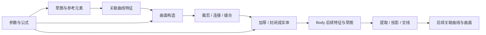

# 线框与曲面的分析与设计

状态：A、B 已进入实现并形成有界基础能力，交付合同与限制以[当前实现](../docs/architecture/current/wireframe-surfaces.md)为准。首批方向由用户确认为**机械零件与工程曲面**：关联曲线 → 曲面构造 → 裁剪/连接/缝合 → 加厚或封闭成实体；后续 C–E 仍为设计/候选，尚非完整工程曲面版本。

任务从[CAD 核心主线](cad-core-roadmap.md)进入；商业行为与具体来源归[曲面建模参考](../docs/references/surface-modeling.md)。本文保留整体模型、后续阶段与验收设计；第 2 节是实施前核对快照，不能覆盖 current。A、B 当前交付限于独立 Part、有限曲线操作及拉伸曲面/加厚，未完成的 Product、发布、交换与通用曲面编辑归后续阶段。

## 1. 推荐方向

建立与现有草图、实体、参数和历史共用的线框/曲面 Feature 体系。保留 Solid Body 的有效材料合同；独立曲线和曲面在几何图形集中组织，产生正式、可引用的几何结果；通过显式实体化特征进入 Body。



图中的回用必须指向合法历史阶段，求值依赖仍为有向无环图。首个交付切片需打通曲线→开放面→加厚→现有实体修改及参数更新，不能仅完成绘图或内核函数。

首批范围包含参数化工程曲线、开放曲面、稳定修剪、面片整理和实体化。后续再扩展双导向/法则、通用支撑 G2、曲面匹配及自由形状编辑；Class-A、SubD、逆向点云拟合、任意三维 GCS 和展开成形不作为首批保证。

## 2. 实施前基础与链路核对快照

| 主题 | 本轮核对的当前事实 | 引入曲线/曲面所需设计 |
|---|---|---|
| 草图曲线 | 稳定实体/端点、精确曲线计算、参数/约束、投影和关联偏移已有链路 | 将合法草图元素作为工程曲线输入；三维独立曲线不交给二维 PlaneGCS 求解 |
| 参考元素与集合 | 点、无限参考线/平面有构造参数；几何图形集是无序容器 | 区分参考轴线与有限曲线、无限支撑与有界面片；扩展集合成员类型 |
| Feature 所有权 | `PartModel.features[]` 中每项当前均须有有效 `bodyId` | 同一 Feature 历史中引入 BODY / GEOMETRICAL_SET 的互斥所有权 |
| 实体构造 | Sweep 路径引用草图；Loft 输出实体，G1/G2 仅覆盖已声明的解析支撑延续 | 独立开放面、非草图三维路径、导向与多结果；不把已有局部 G2 当作任意曲面 G2 |
| 结果与制品 | Revision / DocumentView 通过 Body GeometryKey 暴露制品，Body 接纳要求非空有效 Solid 集 | 曲线/面片结果有独立域与输出引用；原 Body 门禁保持 |
| 持久选择与发布 | PersistentSelection 必须有 `sourceBodyId`；FEATURE_OUTPUT 发布仍求值 Body 前缀 | 来源所有者扩展至几何 Feature 输出，贯通解析、授权、发布与上下文 |
| 导入/导出 | `splitSolids` 拒绝 Solid 外的 Face/Edge/Vertex；现有导入根 Naming 绑定实体定义 | STEP/BREP 开放面、曲线及混合内容的分类、根身份与交换验收 |
| 界面 | 通用拾取字段、选择会话、只读检查器、预览/历史/修复已有边界 | 曲线链、面片、自由边界、保留区域、支撑与结果的角色选择和显示 |

源码入口：[模型](../services/internal/workspace/model.go)、[参考元素](../services/internal/workspace/reference_elements.go)、[所有权/依赖检查](../services/internal/workspace/evaluation_projection.go)、[持久选择](../services/internal/modelcore/topology_naming.go)、[发布解析](../services/internal/workspace/publication.go)、[Worker Proto](../proto/occccad/worker/v1/geometry_worker.proto)、[内核 API](../kernel/api/include/occccad/kernel/kernel.hpp)、[OCCT 构造与 Solid 校验/导入](../kernel/occt/src/occt_kernel.cpp)。限制由代码分支与当前文档核对，未运行新的模型验证。

## 3. 统一定义、所有权与结果

### Feature 与容器

推荐扩展现有 Part Feature 定义和 Command/ChangeSet，不另建一套曲面历史。概念模型如下，字段名不是已定协议：

```text
Feature
  id / typed definition / parameters / suppression
  owner = BODY(bodyId) | GEOMETRICAL_SET(setId)
  inputs = stable references + explicit source stages
  declared outputs = stable output roles

GeometryResult（派生）
  result identity = FeatureId + declared output role
  domain = POINT_SET | WIRE_SET | SHEET_SET | SOLID_SET
  GeometryKey + BREP / VISUAL / NAMING + quality evidence
```

- Solid Feature 归 Body，几何 Feature 归 Geometrical Set；新 Sketch 可按创建上下文归 Body 或 Geometrical Set，使仅曲面的 Part 也能使用二维草图。已有 Sketch 的身份与归属不隐式改变。互斥所有权不能通过伪造 BodyID 实现；已有参考点/轴/面维持其正式定义和稳定 ID，经统一引用/依赖入口参与，不在多个集合重复保存几何真相。
- Geometrical Set 只组织、命名和控制可见性。全 Part 依赖图决定计算顺序，Body 的材料前驱边仅用于 Body 历史。集合的显示顺序不自动产生依赖。
- 首版保留普通无序集合。CATIA Ordered Geometrical Set 的吸收、当前对象与插入重路由另列后续设计，不混入普通集合。输入保留/结果显示使用明确的派生显示规则，不能静默改写其他特征的引用。
- 一项特征可产生多个 Face、曲线支路或不连通分量。稳定输出角色、成员及拓扑 Naming 分别管理；特征显示名、结果数组下标、GLB primitive 和 GeometryKey 均不作业务身份。

### 引用和多结果

统一来源所有者至少区分 `BodyStage(bodyId, featureId)` 和 `FeatureOutput(featureId, resultId)`。子元素继续采用 PersistentSelection 及创建证据；草图实体、参考点/轴/面使用既有稳定引用。Source Revision、实际来源阶段、InstancePath、Root/Variant 均进入解析与预览作用域。

多结果选择显式区分“当前固定成员”与“整个动态结果集”。默认拾取某条曲线/某个面片，不因为上游新增支路而扩大选择。分裂、合并或消失依据真实 lineage 返回 RESOLVED / MISSING / AMBIGUOUS / TYPE_MISMATCH / SOURCE_UNAVAILABLE；需要用户重选时不自动选最近几何或第一条分支。

Trim/Split 的保留分区来自权威候选的命名边界和区域身份。点击位置只用于当前候选选取；不保存屏幕坐标作为区域身份。若支持关联点决定保留侧，该点必须是明确的建模输入，而不是失效后的几何猜绑依据。

### 数据与历史

GeometryResult 的精确几何、网格、Naming、质量报告仍是带来源的制品，不把大型曲面控制网、采样或 BREP 内联进 Revision。用户定义的样条控制点/权重/节点及其稳定身份属于正式定义；算法产生的拟合控制网属于派生结果。

所有者、选择 schema、制品授权及 Proto 是同一次基础合同变更：需覆盖参数槽、依赖/循环、删除影响、Preview、CAS、Undo/Redo、持久选择、冷重建，并在后续互用阶段扩展发布与 Product 快照。未发布结构按现有开发数据边界处理，不能以长期双写/猜测 adapter 掩盖唯一模型的缺口。A、B 实施未重置开发数据。

## 4. 几何语义与算法候选

| 操作族 | 首批合同重点 | OCCT 候选及工程风险 |
|---|---|---|
| 有限曲线、3D 样条 | 已有点/方向、稳定点列或控制点定义；方向、闭合和周期性显式 | 复用精确曲线表示，区别插值与控制点样条；阶次/节点/权重需预算及退化检查 |
| Extract / Boundary / Composite Curve | 输入来源、传播、排序和方向明确，组合不默认近似重拟合 | 精确拓扑提取、Wire 组织及 lineage；共享几何和分裂结果不能靠遍历顺序命名 |
| Projection / Intersection | 明确沿方向/法向模式及修剪面/底层支撑域，允许多结果与相切点诊断 | 投影、Section 等算法；相切、重合、周期缝、多支路和零结果需独立处理 |
| Surface Extrude / Revolve | 有界曲线、方向、长度/角度；开放侧面可独立有效，封盖另作定义 | 复用 Prism/Revol 构造与真实历史；不自动进入材料布尔 |
| Surface Sweep / Loft | 支持开放轮廓；路径/导向/spine/截面/对应为不同角色 | MakePipeShell、ThruSections 非 Solid 路径等；姿态退化、闭合点和多面拆分需冻结意图 |
| Fill / Boundary / Blend | 初期 G0；逐边声明支撑及要求，G1/G2 按可证明范围逐步开放 | BRepFill_Filling、GeomFill/GeomPlate 等；约束冲突、偏差和质量复杂度均可能失败 |
| Split / Trim / Extend | 明确保留/移除、有限支撑及自动延展策略；输出含裁剪边界 | 精确求交、分割和 Face 重建；UV p-curve、孔、周期缝及区域消歧是主风险 |
| Join / Sew | 区分组织连接、拓扑共享和几何修复；检查自由边、连通域和非流形 | Sewing 及实际 Modified 历史；修复/近似需显式策略和偏差，不能静默放宽容差 |
| Offset / Thicken / Close | 偏移产生曲面；加厚产生有厚度的实体；封闭将合格闭壳转实体 | Offset、ThickSolid、MakeSolid 等；凹角、自交、法向、内外壳和厚度奇异需验证 |

候选 API 在设计时核对 OCCT 7.9.1 头文件；A、B 之外的组合尚未证明鲁棒性、完整 Naming 或性能。可以提取当前生成器中可复用的构造/历史组件，但不能仅切换一个 `solid=false` 参数就宣称曲面功能完成。

Composite Curve 默认保留精确成员与有序链，不重拟合；断开的来源需明确多结果。Surface Join 默认要求连通并保留面片身份，Sew 建立共享拓扑，Heal/近似重拟合则改变几何，须单独选择并报告偏差。导向与截面必须满足声明的相交/覆盖关系，不能通过最近点吸附让约束看似成立。

### 有界域、支撑与方向

几何引用需区分有限 Curve、整条底层曲线、裁剪 Face、底层 Surface、Sheet 集合及无限 DatumPlane/Axis。投影与求交默认遵守所选有界对象；使用底层延伸域必须明确选择，不能沿用 `TO_SURFACE` 的无限支撑语义而不告知用户。

点在曲线上需区分弧长距离、归一化弧长比例及原生参数；在曲面上的 UV 同样不能被隐式解释为物理长度。曲线方向、周期闭合点、曲面法向和材料侧都是持久设计意图。

曲线 Offset 区分平面内偏移、支撑曲面内偏移及带指定框架的三维偏移，不能假设任意空间曲线有唯一法向。首批曲线偏移只接纳声明的平面范围；支撑内和一般空间偏移分项扩展。

首版在曲面上创建草图仍限可解析平面；曲面上的投影曲线属于几何 Feature。3D 点/曲线交互明确参考平面、坐标系或稳定支撑，不把视图深度猜测作为永久定义。

### 质量与接纳

- Wire 校验连通、方向、退化与操作所需的自交条件；Sheet 校验 Face/UV/p-curve、方向、连通域、自由边和非流形；Solid 继续现有有效材料门禁。球/锥极点等内核合法退化边需明确分类。开放 Sheet 的零体积不等于无效实体，体积属性在该域标为不适用。
- 周期缝不当作普通自由边；闭壳还需验证流形、可定向、自交、嵌套壳及有效正材料体积。Sew 成功与“可封闭成实体”是两个接纳结果。
- 质量策略分别定义长度、角度、曲率误差、拟合偏差与显示采样精度。参数单位沿用项目合同，内核毫米转换只在边界执行；不采用商业软件或 OCCT 的裸默认值作为本项目阈值。
- G0/G1/G2 分别涉及位置、切向/切平面和曲率关系；几何连续性与同参数导数连续性分别处理。曲线连接按声明的端点检查；曲面接边需指定相邻支撑和法向约定，整条边界必须受检，不能用端点、少量法线或斑马纹显示证明全边满足。
- 区分 `requestedContinuity`、实际可验证范围和测得误差。若只有自适应采样证据，报告其采样/精度范围，不能冒充解析或全域认证。未达到要求即拒绝候选，或由用户改变要求后重新预览，不能静默降级。

## 5. 求值、显示与操作

### 统一求值链

```text
versioned Domain Command
 → owner / typed inputs / parameter / DAG validation
 → immutable source results + evaluator/kernel/quality policy digest
 → coarse-grained Worker geometry operations
 → domain-specific validity + topology lineage + quality gate
 → BREP / VISUAL / NAMING / quality ArtifactReferences
 → verified preview or ChangeSet + CAS Revision
```

Proto 建议增加带类型的几何操作/结果，在现有 Part 求值编排中消费；不把 `ProfilePadSpec` 继续扩成承载所有曲面操作的无类型大袋，也不为每个点、节点或采样发独立 RPC。Worker 不持有业务数据库或可变 Part 真相。

缓存包含规范定义、所有输入结果/阶段、上下文、单位、kernel/evaluator 版本及质量策略。派生结果变化只重算消费者；无关集合重命名/显隐不重建几何。失败传播复用 FAILED/BLOCKED；旧成功几何只读导航，不能重新参与拾取绑定。预览始终不写 Head，取消、CAS 和迟到结果门禁保持。

预算至少覆盖输入成员、交点/分区、面片、NURBS 阶次/控制点/节点、网格与制品字节及执行时间；具体默认值待模型测量确定。循环阶段设置取消检查和 Worker deadline。原生算法无法中途响应时需有超时隔离策略，不承诺即时取消或交互帧率。

### 工作台与选择

推荐在同一 Part 中提供一个“线框与曲面”工作台，共用文档、参数、引用和历史，不复制 WFS/GSD 为两套实现。工作台切换是交互上下文，不能隐式创建 Revision；首次创建几何 Feature 时才按现有规则建立/选用几何图形集。

- 建模命令按曲线、曲面、操作和实体化分组；测量、分析、参数与接口、视图保持明确分类。实际分组由唯一 catalog 注册，实体化命令可在两个工作台共享行为。
- 草图内仍只提供草图绘制/约束；独立曲线与曲面命令在退出 Sketcher 后使用。保持已确认的尺寸分类和无绘制尺寸输入框、无实体尺寸手柄的交互范围。
- 复用 FeaturePickField / SelectionSession：点、曲线/有序链、面片、支撑、导向、spine、截面和保留区域各有角色。列表支持高亮、定位、更换、移除、反向和必要重排；几何不使用 UUID 下拉选择。
- Sweep 与 Loft 用颜色及方向/对应标记表达输入，约束高级选项按需展开；表单不常驻长说明。数量/表达式走已有输入组件，错误及恢复动作走全局反馈。
- Sheet 支持双面显示、明确法向、自由边/内边及可选等参数线；Wire/Point 有独立精确显示与命中通道。GLB/SelectionIndex 映射带 result owner，不能依赖三角形或只有 Body 的键。
- 普通选择、建模选择和分析选择分别过滤；旧输入显示只供本会话合法引用。树中几何图形集、Feature、命名结果与只读参数各自表达职责，不把 Face 数量当作设计步骤数量。
- 连接/边界/曲率分析复用紧凑表格、计数、定位与视区叠加；显示斑马纹/曲率梳是质量观察入口，精确指标来自同一冻结结果。

### 实体、草图与装配互用

新曲线引用应进入现有 Sweep/Loft 的输入解析；已有草图曲线仍通过同一角色合同使用。平面 Sheet 的面可支撑草图，Solid 的边/面可提取或投影出关联几何。Thicken/Close 的输出沿 Body 生命周期与材料操作进入原 Feature 链；三维曲面加厚与已有二维薄壁截面分别定义参数与失败语义。

发布复用 FEATURE_OUTPUT / TOPOLOGY 等既有入口，但解析/合同扩展到几何输出；跨零件仍经 Publication / ContextInput 与接受快照，不直接跟随来源 Head。先支持独立 Part，再验收已支持的直接 READY Product ContextVariant；默认构型、重复 occurrence 和镜像位姿分别验证，不借曲面扩展任意深层编辑。

属性和测量同样校验结果域与 owner/snapshot：Wire 提供适用的长度与端点属性，Sheet 提供面积、边界及法向等属性；实体质量/体积属性不能以伪零值填给曲面。扩展既有测量支持合同，未接入的模式明确报不支持，属性检查器继续只读。

STEP/BREP 交换需支持 Wire/Sheet/Solid 及混合内容分类，保留 Part/Product 结构、单位和适用颜色，导入根分配冻结正式身份。重新导入是新的身份根，不按 STEP 编号或最近几何恢复旧引用。首版只承诺精确 B-Rep/几何交换；跨产品传递本软件完整参数历史另行设计。

## 6. 分阶段范围与完成门

| 阶段 | 功能范围 | 完成门 |
|---|---|---|
| A：最短完整链 | 所有权/结果/引用/制品基础；草图或有限线框 → Surface Extrude → Thicken → 原 Body 修改 | 正式预览/提交、参数更新、失败修复、Undo/Redo、冷读取及 Naming；空 Body/仅曲面 Part 可显示和选择 |
| B：关联曲线网络 | Extract、Boundary、有限线/圆弧/3D 样条、点在曲线、Composite、投影/交线、平面内 Offset、限定端点/方向的 G1 连接、曲线 Split/Trim/Extend 与基本变换 | 多支路和方向稳定，原 Sweep 能消费正式曲线输入；缺失/分裂不猜绑 |
| C：首个工程曲面版本 | Surface Revolve、单路径 Sweep、开放/闭合截面 Loft、G0 Fill；Surface Split/Trim/Extend、Join/Sew、有限范围常量 Offset、Close；开放几何 STEP/BREP 交换、基础测量及发布互用 | 导流罩/薄壁壳体从构造到实体完整流程；自由边、非流形、周期缝、自交及交换缺口有真实验收。此门之前不称为完整工程曲面版本 |
| D：形状与质量控制 | guide / spine / coupling 扩展、逐边支撑 G1、受限 G2、Boundary / Blend、曲率与斑马纹分析 | 逐能力公开适用输入；定量验证全边要求和误差证据，超限不降级；法则/双导向按独立子项接纳 |
| E：后续候选 | 自由曲面匹配/控制点编辑、更复杂偏移修补、Law/Isoparametric、Ordered Geometrical Set、Class-A 专项 | 单独设计与测量，不扩大 A–D 承诺；SubD/点云/展开另立领域评审 |

阶段是实现优先级，不是将质量和历史推迟到末期；A 起即有域校验、来源 Naming、基本分析、参数化及历史。先完成 A 的可运行闭环，再扩展 B/C，避免先堆数十个无完整下游能力的命令。

## 7. 检验设计

| 模型/场景 | 关键断言 |
|---|---|
| 矩形开放面与加厚 | 曲面面积 A、加厚体积 A×t；Sheet 无实体体积仍有效，实体有侧壁及完整 Naming；参数/单位更新传播 |
| 柱面与周期缝 | 半径 R、高 H 的整周柱面面积 2πRH；向外加厚体积 π((R+t)²−R²)H；周期缝、法向和边界分类正确 |
| 三维关联路径 | 点/样条参数变化驱动 Surface/Solid Sweep；非平面姿态、反向、闭合、尖点及扭转意图明确 |
| 带孔修剪面 | 保留内/外分区的面积与后续加厚体积正确；UV 边界、孔、反向及区域消失不错误重选 |
| 六面壳体与缺面 | 六面闭壳可封闭成体；缺一面仍是合法开放 Sheet，Close 明确拒绝；三面共边的非流形与方向冲突可定位 |
| 投影/交线多结果 | 两支路新增、删除、分裂/合并、相切点及重合输入；固定成员不吸收新增支路，歧义不能选择第一项 |
| Fill / Blend 连续性 | 有解析支撑的 G0/G1/G2；检查整个边界及曲率误差、参数化不变性，超约束或不满足公差时拒绝 |
| 偏移与厚度极限 | 凹角、薄小面、局部自交、厚度达到曲率奇异处失败；不把容差调大隐藏洞或重叠 |
| 关联修复与历史 | 草图/Datum/曲线/面片/Body 混合 DAG，删除影响、循环、冻结阶段、显式修复、Undo/Redo 与冷热身份一致 |
| Product 与发布 | 独立默认构型、重复/镜像 occurrence、接受版本、跨文档发布缺失/类型变更；位姿只应用一次 |
| 导入/导出 | 曲线、开放壳、闭壳、实体及混合 STEP/BREP；类型、单位、颜色、边界/体积和根 Naming；不要求跨重新导入保留旧 UUID |
| 预览、权限与资源 | 取消/迟到响应/CAS/未知回执不覆盖 Head；制品按 owner/result/snapshot 授权；预算/超时不产生伪成功 |

每项分内核、Workspace、真实 Router/Worker、浏览器四层举证。算法测试不能替代创建/编辑/修复与历史，截图不能替代精确几何或连续性指标。A、B 的测试入口与实际范围见 current；本表包含后续 C–E 的接纳模型，不表示整张矩阵已通过。容量、工业成功率及性能结论仍需独立测量。

## 8. 已确定的基础与后续评审

1. 接受“Solid Body + Geometrical Set 中的几何 Feature + typed result”作为基础，统一扩展持久选择的 source owner；不削弱 Solid 接纳规则。
2. 接受 A→B→C 的工程曲面优先级，D 的高阶支撑按实测分项开放；不以商业软件菜单齐全作为首批目标。
3. 选择同一 Part 内的单一线框/曲面工作台和共用实体化命令；普通集合先行，有序/吸收另行评审。
4. A、B 按有界操作落实协议、模型及门禁；C 起继续逐项对齐精度、失败/修复、资源预算及开放几何交换，不将本文未交付的类型与操作名当成公共接口。
